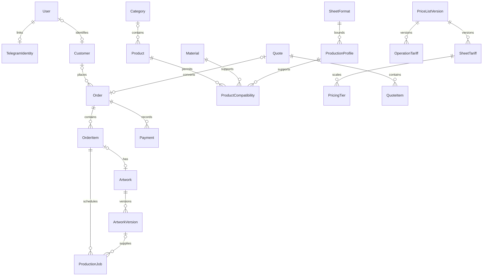

# База данных MVP

Источник: [ТЗ v1.0](STUDIO_OS_MVP_TZ.md), предоставленное пользователем 2026-11-03. PostgreSQL / Prisma 7.10.1; Supabase остаётся единственной рабочей БД. Этот этап не создаёт API, авторизацию, калькулятор или интерфейсы.

На этапе 4 добавлены AdminCredential, AdminSession и LoginThrottle (всего 27 таблиц) с отдельной миграцией и RLS; роль OPERATOR. Политика доступа, хеширование и bootstrap описаны в [AUTH](AUTH.md). Seed не создаёт учётных данных.

## Ключевые связи



24 таблицы: 20 обязательных моделей (Order/OrderItem и Artwork/ArtworkVersion отдельно) плюс PriceListVersion, QuoteItem, ProductCompatibility и связь включённых операций SheetTariffIncludedOperation. StatusHistory ссылается ровно на один заказ/позицию/макет/платёж/задание. AuditLog имеет FK автора и исторический entityType/entityId: общий объект аудита намеренно без полиморфного FK.

## Инварианты

- Деньги: Decimal(18,2); ставки за лист/операцию — Decimal(18,4). Передавать строками/Prisma.Decimal, не Number/float. Валюта MVP — UZS; точное правило округления хранится в версии прайса и snapshot.
- Размеры и поля — Decimal(10,3) в мм; плотность — г/м². Технические даты — timestamptz(3), UI позднее отображает Asia/Tashkent. Telegram ID — BigInt, не username.
- Order.status, Order.paymentStatus, Artwork.status, ProductionJob.stage/status раздельны. Payment — записи поступлений/возвратов, не реквизиты карт. Идемпотентные ключи заказа/платежа и provider/externalId уникальны.
- StatusHistory.field явно различает status, paymentStatus и другие оси состояния одного объекта.
- Order/OrderItem содержат обязательные JSONB snapshot параметров/расчёта/цены. Они должны включать версию схемы и движка, выбранные ставки и ступени, включённые операции, резерв, валюту/округление и breakdown. Нормализованные количества разделяют изделия, оплачиваемые и производственные листы. Дальнейший сервер формирует/проверяет содержимое snapshot; БД проверяет наличие объекта и точные суммы.
- PriceListVersion версионирует весь прайс. Дата/минимумы/валюта и конкретные ставки сохраняются в snapshot. После публикации ставки и коммерческие параметры неизменяемы; разрешены завершение срока и перевод в RETIRED. Изменения цен — через новый DRAFT. Ступени по числу листов не пересекаются; операции, включённые в базовую цену, связаны с тарифом в той же версии.
- У ProductionProfile своя рабочая область; она вместе с полями не выходит за физический лист. Никакие размеры оборудования или возможности реальных материалов seed не предполагает.
- Artwork.approvedVersion связан составным FK только с собственной версией. Новая версия по умолчанию UNDER_REVIEW и не наследует согласие. ProductionJob хранит ссылку на конкретный файл и свой snapshot; версия другого OrderItem отвергается.
- Клиента лучше архивировать. Hard delete устанавливает customerId в NULL; заказ, позиции, платежи, история и финансовые snapshot сохраняются. Каталог архивируется; snapshot не зависит от актуального названия/тарифа. Удаление финансовых записей с зависимостями ограничено FK. Удаление клиента не анонимизирует старые snapshot автоматически: политику хранения/удаления контактов нужно реализовать отдельно.
- Индексы покрывают клиентские заказы по дате, состояния/сроки/ответственного, доску, тарифную комбинацию, версии файлов и историю объекта. Добавлены SQL CHECK, частный индекс нормализованного email и PostgreSQL-триггеры; они находятся в миграции, а не только в Prisma schema.
- RLS включён для всех 24 таблиц; клиентских политик пока нет. Владельцы БД/привилегированный backend могут обходить RLS; будущая серверная проверка роли и принадлежности обязательна. Объекты хранилища приватные, в БД только ключи Supabase Storage, без публичных/signed URL и токенов.

Условия коммерческих переходов, проверка оплаты по сумме, запрет старта без разрешений/оплаты/согласования, аудит в одной транзакции и JSON-схемы snapshot относятся к будущему прикладному слою. Модель данных их не подменяет.

## Запуск и проверка

```sh
pnpm install --frozen-lockfile
pnpm db:generate
pnpm db:validate
pnpm db:migrate
pnpm db:seed
pnpm db:seed
pnpm build
```

Для migrate/seed задайте DATABASE_URL в окружении или локальном .env (прямое/session соединение, не transaction-pooler). Миграция 20261103070000_mvp_database атомарна и применяется к пустой БД. Использовать migrate deploy, не db push: последний не переносит пользовательские SQL-инварианты. Генерация клиента не требует соединения с БД и автоматически запускается перед build/typecheck.

Seed транзакционный: A4=210×297, A3=297×420 и три демонстрационных материала UNAVAILABLE. Upsert по code с update:{} не перезаписывает существующие настройки. Нет пользователей, контактов, заказов, опубликованных тарифов и неподтверждённых профилей оборудования.

Для интеграционной проверки задайте DATABASE_TEST_URL отдельной **пустой** БД и выполните pnpm db:test. Тест отказывается от непустой БД, применяет миграцию дважды, запускает seed дважды, проверяет сохранение правок и SQL-инварианты. Тестовые операции выполняются с rollback; остаются только справочники seed. Никогда не указывать рабочую БД.
